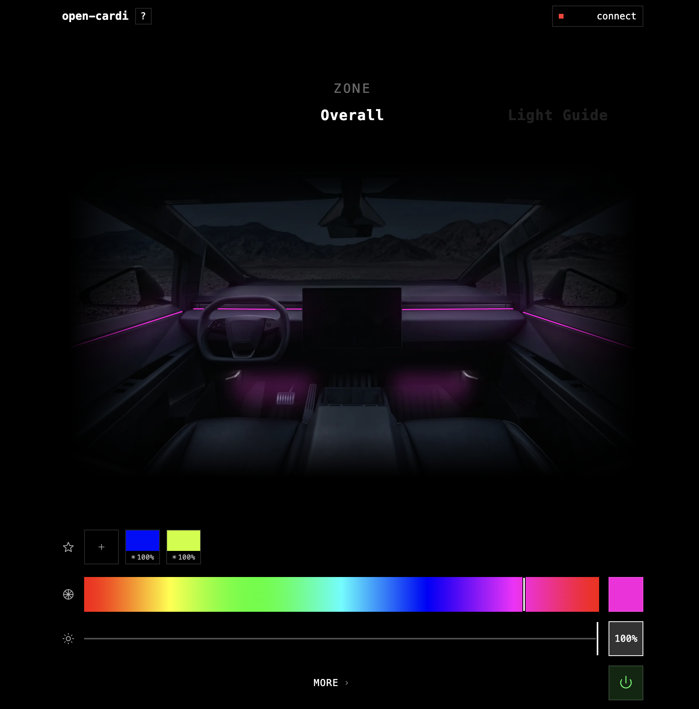

<div align="center">

  

  <h1>open-cardi</h1>

</div>

An open-source replacement for the **Cardi Tech** Android app ([`com.qc.xq`](https://play.google.com/store/apps/details?id=com.qc.xq)) — controls Cardi K3 / K4 Active Ultra (and other ConSmart-family) RGB ambient lighting kits. open-cardi reverse-engineers the same BLE protocol — no ads, no tracking.



- **Android app (recommended):** download the APK from [Releases](https://github.com/harshmandan/open-cardi/releases). Works on the phone and on Android Auto.
- Web app: [opencardi.harsh.ink](https://opencardi.harsh.ink) — **not recommended**, see below.
- Writeup: [Reverse-engineering the Cardi Tech BLE protocol](https://harsh.ink/blog/reverse-engineering-cardi-tech)

## Use the Android app, not the web app

The web app can lock the kit into a blinking white/blue state that no app can reach. The only way out is a power cycle, then setting a colour from the vendor app. The Android app can't cause this.

What happens: with the car on and the headlamps on AUTO, the kit sometimes resets when colours change — with any app, including the vendor's. Normally it comes straight back. But if the Bluetooth link was set up with a large packet size (ATT MTU), the reset leaves it stuck in the blink.

- The vendor app and the open-cardi Android app keep the default packet size (23 bytes). The kit always recovers.
- **Chrome asks for the largest packet size (517) on every Web Bluetooth connection, and the kit agrees to 131.** A web page can't change or prevent this ([W3C issue #383](https://github.com/WebBluetoothCG/web-bluetooth/issues/383)). We've seen the same 131 from Chrome on Android and from macOS; other platforms are untested.

We confirmed it on 2026-10-18 with the same Android build, switching only the packet size: at 23 the kit recovered from every reset; at 131 it locked within 6 seconds. The bisection is written up in the commit that changed the Android app (`feat(android): connect like the vendor app…`); `debug/btsnoop.py` decodes the phone's Bluetooth log if you want to check your own kit.

The web app stays online for reference and for kits that don't reset, but use it at your own risk.

## Android app

Native Kotlin (`android/`), with an Android Auto screen. It connects the way the vendor app does (default packet size, normal connection interval), reconnects on its own if the kit resets, lists nearby kits by name and MAC to choose from, and has Lock, Unlock and Factory reset under Settings.

Build it yourself:

```sh
cd android
./gradlew :app:assembleRelease   # app/build/outputs/apk/release/app-release.apk
./gradlew :protocol:test         # shared byte contract with the web app
```

Android Auto only lists non-debuggable apps, so sideloaded testing needs the release build.

## How it works

The kit's MCU is a Beken BK343x exposing a single GATT service (`0xFFF0`) with a write characteristic (`0xFFE2`, write-without-response) and a notify characteristic (`0xFFE1`). All commands are short framed packets — most are 6 bytes `ED <op> <a> <b> <c> E9`, plus a few odd ones (`FE _ EF` for zone select, `30 _ 03` for speed, `FA _ AF` for app mode).

Decoded ops (from decompiling two vendor apps — Cardi Tech 1.20 and Cardi-RGBW 1.2.2 — plus HCI snoop replay):

| op              | wire                         | use                                              |
| --------------- | ---------------------------- | ------------------------------------------------ |
| color           | `ED 49 R G B E9`             | RGB × brightness, pre-multiplied client-side     |
| master on / off | `ED F0 …` / `ED 0F …`        | global kill switch                               |
| zone select     | `FE z EF`                    | scopes the next color/pattern to one zone (1..8) |
| pattern         | `ED <Mods[i]> 00 00 00 E9`   | 23 presets, opcodes table-driven from `Mods[]`   |
| speed           | `30 s 03`                    | 1..100, applies to current pattern               |
| mic             | `ED 34 m m m E9` / `ED 33 …` | 4 reactive modes (Classic / Soft / Jump / Dance) |
| app mode        | `FA 01/02 AF`                | Classic vs Starlight rendering on the MCU        |
| lock code       | red + 5× master off/on       | stop following nearby Cardi controllers (\*)     |
| unlock (decode) | green + 5× master off/on     | undo lock code (\*)                              |
| version query   | `1E 00 E1`                   | reply `0C …`, version in byte 4 — K3 ignores it  |
| factory reset   | `F1 F2 F3 F4 F5 F6`          | restore factory settings; the kit restarts       |

(\*) Lock code and Decode have no opcode of their own: the firmware recognises a colour followed by five master off/on pairs, 200 ms apart. Open-cardi sends them as **Lock** and **Unlock**, from **Settings** (Android) or **More** (web), and caps master writes at 4 per 2.5 s so the power button can't send one by accident. That they stop cross-car colour changes is inferred from the vendor's naming (锁码 / 解码), not yet confirmed.

Both clients send a two-frame handshake on connect (`3C AA AA 3D` state, `0E AA E0` zone), then everything else is fire-and-forget writes — no ACKs, no flow control. State is mirrored locally so reconnects can re-apply the last snapshot.

K3 only has 2 effective zones (front-strip + footwell); K4 exposes 8. The UI hides K4-only zones behind a toggle.

## Web app stack

SvelteKit 5 (runes) · TypeScript · Tailwind v4 · Bun · Web Bluetooth · `navigator.bluetooth.requestDevice` filtered by service `0xFFF0` + name prefixes (`CarDiLits`, `iLits`, `BaoYin`, …). Served as a PWA so it installs on Android home screen; iOS needs [Bluefy](https://apps.apple.com/us/app/bluefy-web-ble-browser/id1492822055) because Safari has no Web Bluetooth.

## Supported device families

By BLE name prefix (all share the ConSmart-family firmware on service `0xFFF0`):

`CarDiLits` · `iLits` · `BaoYin` · `CaChuang` · `CarL` · `MTF-LIGHT` · `AIKON-LIT` · `Dream` · `Flash`

Tested end-to-end on Cardi K3 / K4 Active Ultra. If your kit advertises a different prefix, see **Debug** below.

## Develop (web app)

```sh
bun install
bun run dev
```

## Debug

A standalone Python REPL (`debug/open-cardi.py`, Bleak) lets you talk to the kit without the web app — useful for poking unknown ops, adding a new device prefix, or verifying captures. Quick start:

```sh
uv run debug/open-cardi.py scan    # find the device
uv run debug/open-cardi.py repl    # interactive prompt
```

See [`debug/README.md`](debug/README.md) for the full command reference and the workflow for onboarding a new device family. For the deeper reverse-engineering walkthrough (HCI snoop capture, APK decompile with jadx, protocol replay), see the [writeup](https://harsh.ink/blog/reverse-engineering-cardi-tech).

## License

[MIT](LICENSE).
